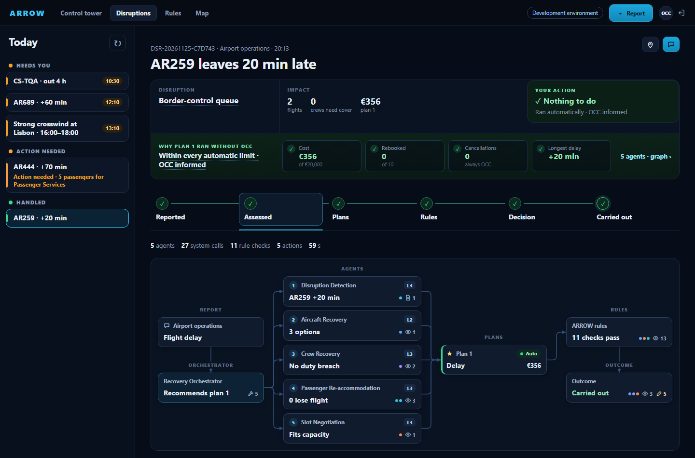
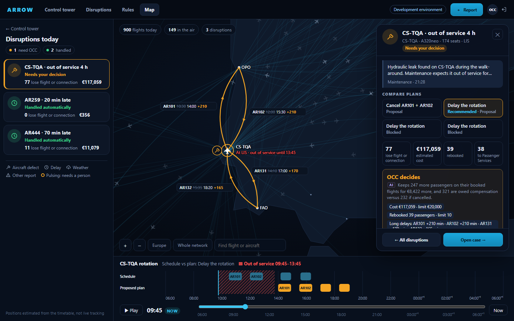
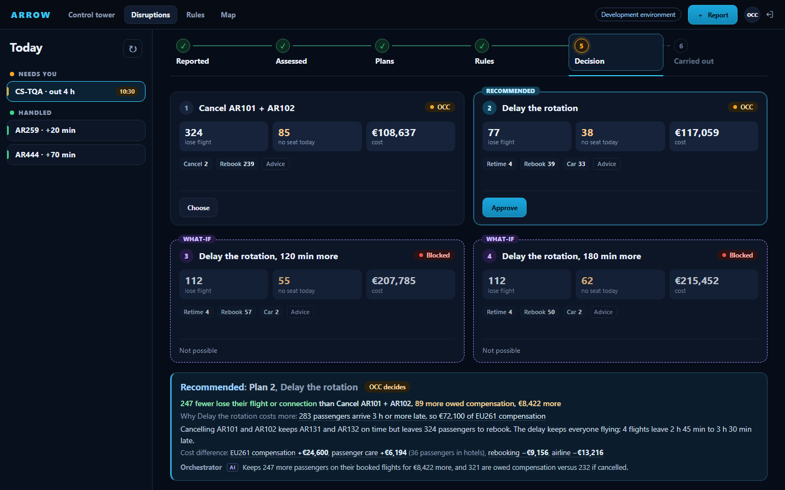
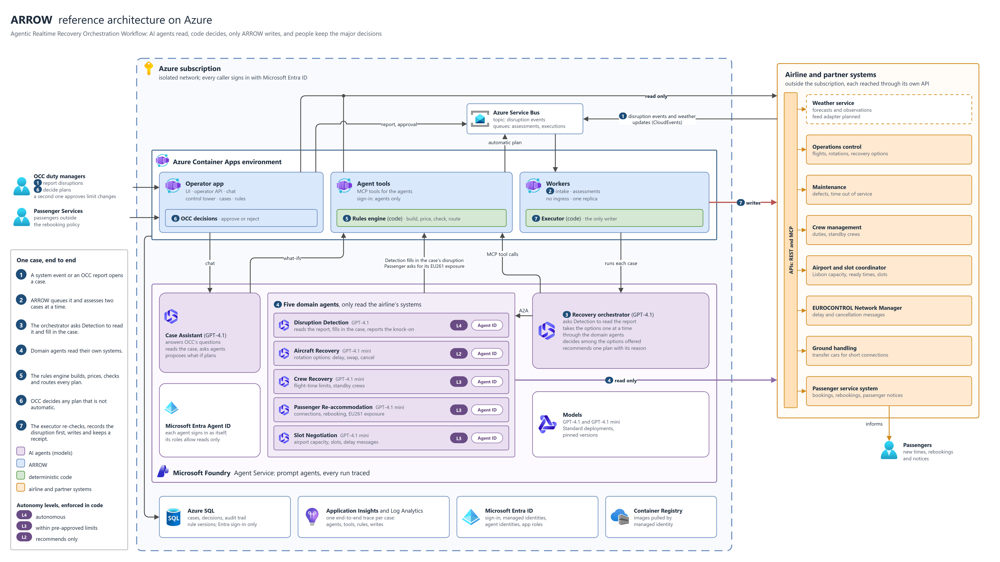

# ARROW: Agentic Realtime Recovery Orchestration Workflow

ARROW helps an airline's Operations Control Centre (OCC) recover from a disruption. AI agents
assess the disruption across every desk at once; deterministic code builds, prices, checks and
routes every recovery plan; a human stays in the loop for every major decision; and only ARROW's
own identity writes to the airline's systems. It is a reference implementation on
Microsoft Azure that runs against sample airline systems on a generated operating day, and the
[deployment guide](infra/README.md) deploys it to any Azure subscription.

| Document | What it is |
|---|---|
| [Executive deck](docs/presentation/arrow-executive-briefing.pdf) | The investment story for the airline's chief executive, finance, technology and operations officers, with the live demo at its centre |
| [Blog post](docs/blog/arrow-agentic-disruption-recovery.md) | The architecture, the agent loop and how code checks every plan, for architects |
| [Architecture diagram](docs/architecture/arrow-architecture.png) | How ARROW is built; this README explains it, from [Architecture](#architecture) to [Failure domains and scaling](#failure-domains-and-scaling) |
| [Deployment guide](infra/README.md) | Deploys ARROW step by step into an Azure subscription |

## What the duty manager sees



*A 20-minute delay to AR259: five agents assess it, every rule passes and ARROW carries out the
plan, informing the OCC (development environment).*



*CS-TQA out of service for 4 hours on the operations map, with the recommended plan's new times
for its next four flights (development environment).*



*The OCC's decision on CS-TQA: two priced plans, and two what-if plans asked in the case chat that
ARROW's rules block (development environment).*

## The business problem

Disruption is a network problem. In 2025 the average departure in Europe was delayed by 14.7
minutes, down from 17.4 in 2024; 6.5 of those minutes, 44%, were knock-on delay passed on from
earlier flights, more than airline causes (3.7), en-route air traffic flow management (1.8),
airports (1.6) or weather (0.5) [1]. That year Lisbon had the weakest departure punctuality of
Europe's 30 busiest airports: just under 51% of its departures left within 15 minutes of
schedule [2]. For the airline, a minute of delay at the gate costs about EUR 45 while the delay
stays under 30 minutes, and EUR 166 averaged over all delays, in 2022 prices [3]: the longer the
delay, the more each minute costs. These averages cover crew and maintenance time, the little
fuel the auxiliary power unit uses at the gate, passengers' rebooking, care and compensation,
lost future bookings and the knock-on delay to later flights; passenger costs are the largest
part.

Much of the passenger cost is set by law. Under Regulation (EC) No 261/2004 (EU261), a passenger
whose flight is cancelled at short notice, or who arrives three hours or more late, is owed EUR
250, 400 or 600 by distance unless extraordinary circumstances caused it [4, 5]. It is paid in
money; a voucher needs the passenger's signed agreement [4]. An ordinary technical defect is not
extraordinary, and meals, calls and a hotel are owed while passengers wait even when the cause
is [5]. A study for the European Commission estimated airlines' EU261 costs at about EUR 5
billion in 2018, when 38% of eligible passengers claimed and were paid [6]. From 23 October 2027
the amounts stay the same, and an airline must pay a claim or justify its refusal within 30
days [4].

The case behind ARROW is a Portuguese airline with a Lisbon hub and 900 flights a day. Its
controllers re-plan aircraft, crews, slots and passengers desk by desk, and a recovery takes 12
to 24 hours. The case asks for faster recovery, less EU261 compensation and fewer cancellations.

## Architecture



Everything ARROW runs on sits in one Azure subscription. ARROW runs as three container apps on
Azure Container Apps, from one image: the operator app (the OCC's screens, their API and the Case
Assistant), the agent tools (ARROW's tools for the agents, which build, price and check plans) and
the workers (case intake, the assessments and the executor). Only the workers may write to the
airline's systems, and nothing can call them: they have no inbound endpoint. The airline's and
its partners' systems stay outside, each reached through its own application programming
interface (API), and passengers hear from the airline's passenger service system. The editable
source is [arrow-architecture.drawio](docs/architecture/arrow-architecture.drawio).

## How it works

1. **A disruption is reported.** A duty manager types a report, or an airline system publishes an
   event to Azure Service Bus. ARROW opens one case at once and puts it in a queue. ARROW's workers
   app runs two assessment workers: each takes one case from the queue and runs one assessment, so
   two cases are assessed at once and the rest wait their turn.
2. **The Detection agent fills in the case.** In Microsoft Foundry Agent Service, the recovery
   orchestrator asks the Disruption Detection agent to read the report. Detection fills in the
   case's disruption with one of three ARROW tools, one per disruption type because each type
   has its own fields for code to check: `record_flight_delay` (flight, minutes, cause),
   `record_aircraft_defect` (aircraft, time out of service) or `record_weather_forecast`
   (airport, forecast period, hazard). Code checks each value against the report and today's
   operation, stores the typed facts on ARROW's case and returns the knock-on: the flights made
   late if nothing changes. No airline system changes. From here on, ARROW and the agents ask
   the airline's systems about the disruption by its facts: a delay's flight, minutes and cause;
   a defect's aircraft and time out of service; a forecast's airport, hazard, window and reduced
   hourly rate.
3. **The domain agents assess, read only, one option at a time.** The Aircraft Recovery agent
   lists the recovery options. The orchestrator takes them one at a time, delay first, and asks
   the Crew Recovery and Passenger Re-accommodation agents and, when departures move, the Slot
   Negotiation agent about each, over the Agent-to-Agent (A2A) protocol. Each agent reads its own
   system through Model Context Protocol (MCP) tools, signed in with its own Microsoft Entra Agent
   ID that holds read roles only [12]. The Passenger agent reports the EU261 exposure from the same
   code that prices plans.
4. **Code builds each plan before the next option.** The orchestrator decides which of the
   options the systems offered to take; ARROW's code builds the plan from the systems' answers,
   and the rules engine checks and routes it ([The rules engine](#the-rules-engine)).
   The orchestrator stops at the first plan that can run automatically, and builds at most four.
   Stopping there never skips a better automatic plan: any aircraft change, cancellation,
   airport request or weather plan always goes to the OCC, so only a delay that keeps the same
   aircraft and stays within every limit can run automatically. Until then, code holds the
   orchestrator to the options offered: a submission that leaves one without a plan is sent back
   once, and if it comes again the OCC sees which options were not assessed.
5. **The route decides who acts.** An automatic plan runs at once and the OCC is informed; any
   other plan waits for an OCC duty manager; a blocked plan is never offered.
6. **Only ARROW's executor writes.** It runs in ARROW's workers, whose identity is the only one
   that writes to the airline's systems, and only for automatic or approved plans. It re-checks
   the sources, then records the
   disruption in the system that owns it as the plan's first action: a delay with its cause in
   operations control, or a defect in maintenance, which marks the aircraft out of service. That
   system issues its own event number then. Every other action depends on that record and goes
   through its recipient's own API, each with a receipt; if the record fails, nothing else runs
   and the OCC sees why. A weather forecast is not recorded (the weather service owns it), nor is
   an event that already carries its source system's event number, and a rejected plan records
   nothing.
7. **Weather is planned from the forecast and acted on when confirmed.** A terminal aerodrome
   forecast (TAF) is the airport's weather forecast; an aerodrome routine meteorological report
   (METAR) is the weather observed at the airport. From a forecast, ARROW opens one case
   for the network and the OCC approves the chosen plan once. The reversible part runs at once:
   passengers are warned of possible delays, standby crews are alerted and dispatch gets fuel
   and alternates advice. The rest waits until an observation, an amended forecast or a
   EUROCONTROL regulation confirms the hazard: retimes, holds, delay messages to EUROCONTROL,
   standby calls, rebooking, transfer cars and new times. An amended forecast that
   drops the hazard stands the plan down.

**Retries are decided by code, never by the model.** A temporary failure, such as a rate limit, a
service that is briefly unavailable or a failed tool call inside a Foundry run, is retried with
exponential backoff and random jitter: the first wait is 15 seconds and each later wait doubles,
and every wait varies randomly by up to 20%. When the service asks for a longer wait (its
`Retry-After` header), ARROW waits that long, up to 5 minutes. A case gets at most four
attempts, all within its 15-minute assessment window and only before any plan exists. A call
that may still be running is never repeated.

**The case's autonomy levels are enforced in code, not by the agents' instructions.** The
Detection agent, at autonomy level 4 (L4, autonomous), fills in the case's disruption itself,
but only through typed tools whose every value code checks, and it changes no airline system.
The Crew, Passenger and Slot domains, at level 3 (L3, within pre-approved rules), see their
actions run automatically only inside the rules engine's limits. The Aircraft agent, at level 2
(L2), only recommends: an aircraft change always goes to the OCC.

**The OCC can ask "what if?" before deciding.** While a case waits for the OCC, a duty manager
can ask the Case Assistant, the AI chat on each case, for example "what if maintenance takes
30 minutes longer?". ARROW builds, prices and checks that variant with the same rules engine and
shows it as a dashed what-if plan after its own plans; a what-if is never recommended or run
automatically, and the OCC still decides.

## The agents

Seven prompt agents run in Microsoft Foundry Agent Service, each with its own Microsoft Entra
Agent ID. All run at temperature 0 on pinned model versions (GPT-4.1 and GPT-4.1 mini, version
2025-04-14, Standard deployments in the region), and each answers in a strict JavaScript Object
Notation (JSON) schema that code checks. The table lists every tool an agent has: the airline
systems' read tools, the domain agents over A2A, and ARROW's tools.

| Agent | Autonomy | Model | Reads | ARROW tools it may call |
|---|---|---|---|---|
| Disruption Detection | L4, autonomous | GPT-4.1 | Operations control: the disruption by its facts and the aircraft's rotation (`get_disruption`, `get_aircraft_rotation`) | `record_aircraft_defect`, `record_flight_delay`, `record_weather_forecast`: they fill in ARROW's case only |
| Aircraft Recovery | L2, recommends | GPT-4.1 mini | Operations control: recovery options: delay, swap, cancel (`get_recovery_options`) | none |
| Crew Recovery | L3, within pre-approved rules | GPT-4.1 mini | Crew management: flight-time limits, standby crews (`assess_crew_recovery`, `get_reserve_options`) | none |
| Passenger Re-accommodation | L3, within policy limits | GPT-4.1 mini | Passenger service system: broken connections, rebooking plan (`assess_passenger_recovery`, `get_rebooking_plan`) | `get_compensation_exposure` |
| Slot Negotiation | L3, within allocated slots | GPT-4.1 mini | Airport and slots: hourly capacity, delay messages (`assess_slot_recovery`) | none |
| Recovery orchestrator | not a domain agent | GPT-4.1 | The five domain agents, over A2A | `get_playbook`, `record_case`, `build_plan`, `submit_plan` |
| Case Assistant | not a domain agent; explains and proposes, the OCC decides | GPT-4.1 | The case, and the five domain agents over A2A | `read_case`, `what_if`, `get_playbook` |

The orchestrator chooses only among the options the systems offered; the OCC sees its
recommendation and reason marked as AI. The agent definitions are in
[infra/ops-app](infra/ops-app).

## What ARROW costs to run

For the case's 900 flights a day, ARROW would assess about 45 to 155 cases a day, 16,000 to 57,000
a year. The 155 is ARROW's estimate from EUROCONTROL's European averages [14]: about 150 delays of
more than 15 minutes that start on their own flight, each with its knock-on in the same case, plus
about four aircraft defects and a weather forecast. The 45, an assumption, counts only the larger
disruptions, about 5% of flights.

| | Per month | Per year |
|---|---|---|
| Model tokens, EUR 0.04–0.11 a case, measured in a development run at Azure list prices | EUR 55–520 | EUR 660–6,200 |
| Platform for one environment, as the [deployment guide](infra/README.md#cost-and-budget) estimates it | about EUR 290 | about EUR 3,400 |
| **Total** | **roughly EUR 350–800** | **roughly EUR 4,000–9,500** |

Integration with the airline's systems, support and any Defender for AI scanning of model tokens
(at most EUR 0.035 a case) are not included.

## The rules engine

A plan goes through four steps. The orchestrator decides, code writes the plan, the rules engine
checks and routes it, and a separate executor carries it out. No model writes a time, a count or
a price.

1. **The orchestrator decides.** From what the domain agents found, it decides which of the
   options the systems offered to take, and calls ARROW's `build_plan` tool with that decision:
   an aircraft option operations control offered (delay, swap or cancel), any standby crews Crew
   offered, whether to rebook, whether to send delay messages, and which of the OCC's standard
   actions to use. The decision holds only identifiers and yes-or-no choices; `build_plan`
   refuses any other field.
2. **Code writes the plan.** ARROW asks the systems itself: operations control gives the new
   times, carried down the aircraft's rotation; booking says which bookings move to which
   flights; crew gives the duty changes; the slots system says whether Lisbon's hours still
   fit. Code then prices the plan bottom-up: airline cost from EUROCONTROL's Standard Inputs [3],
   EU261 compensation per booking, care and rebooking, each counted once [4]. Prices are
   indicative. The plan is stored on the case as JSON.
3. **The rules engine checks and routes it, and executes nothing.** Every rule records its input,
   limit and result, so the OCC sees why a plan went where it did. The route follows a fixed
   order:
   - **Blocked**, never offered: a failed or unanswered safety check, such as a crew flight-time
     limit no standby crew covers, Lisbon's hourly capacity, or any check without an answer.
   - **The OCC decides**: an aircraft change, a cancellation, an airport or slot request, a
     weather plan, a delay at the EU261 care thresholds, cost above EUR 20,000, more than 10
     rebookings, declining to rebook, or more than two standby crews or a base's last.
   - **Automatic** otherwise, and the OCC is informed.

   Passengers who cannot be rebooked within policy go to Passenger Services without changing the
   route. Only the cost and rebooking limits can change, and only when a second duty manager
   approves; each plan keeps the rule version it was built under.
4. **A separate executor carries out only an automatic or OCC-approved plan.** The approval
   screen lists the actions the executor will send: both are built from the stored plan by the
   same code. Before the first call the executor checks that the plan is the one approved,
   recomputes its route and re-reads the sources; anything changed goes back to the OCC.
   Booking's rebooking answer in step 2 came with a check code: the executor sends that code with
   the rebooking, and booking recalculates and refuses the write if anything changed ("rebooking
   plan differs from the validated plan"), so the case returns to the OCC. Crew duties work the
   same way, and ARROW seals the approved plan with its own check code, computed over its
   flights, the domains' assessments, the systems' answers, the rule version and limits, and the
   standard actions. The actions go in a fixed order, each with a receipt
   ([Contracts](#contracts)): the disruption's record in the system that owns it; any airport
   slot request; the flight changes; EUROCONTROL and airport messages; crew duties; rebookings;
   transfer cars. A weather plan records nothing first: its passenger warnings and standby
   alerts go at approval, and the rest, with the passengers' new times, waits until the hazard
   is confirmed.

**One plan, end to end.** In a Dev run,
ground handling in Hamburg was short of staff and AR444 was expected to leave 70 minutes late
(Test Bench case 2). The orchestrator's decision, as `build_plan` received it:

```json
{
  "aircraft_option_id": "delay",
  "reserve_option_ids": [],
  "rebook": true,
  "delay_messages": true,
  "playbook_actions": ["RETIME", "REBOOK"]
}
```

The plan code wrote on the case, trimmed to a few fields, with times and limits shortened:

```json
{
  "flights": [
    {"flight_no": "AR444", "std_local": "12:10"},
    {"flight_no": "AR861", "std_local": "16:04"},
    {"flight_no": "AR862", "std_local": "18:12"}
  ],
  "validation": {"rebooking": {"rebooked_passengers": 6, "transferred_passengers": 19}},
  "cost": {"total_eur": 11079},
  "policy": {
    "route": "auto",
    "checks": [
      {"rule": "Cost limit for automatic plans", "input": "€11,079", "limit": "€20,000", "result": "pass"},
      {"rule": "Rebooking limit", "input": "6 passengers", "limit": "10 passengers", "result": "pass"},
      {"rule": "Lisbon capacity", "input": "fits at LIS", "limit": "Hourly allocation", "result": "pass"},
      {"rule": "Passengers without rebooking", "input": "5 passengers", "limit": "Passenger Services decides", "result": "expert"}
    ]
  }
}
```

AR444 moves from 11:00 to 12:10, and its four later flights about an hour each. Booking rebooks
6 passengers, a car takes 19 to short connections, and 5 go to Passenger Services. The cost,
EUR 11,079, is airline cost EUR 6,578, compensation EUR 3,500 for 11 passengers, meals EUR 95 and
rebooking EUR 906. Nine of the ten checks pass and the tenth goes to Passenger Services, so the
plan ran automatically: 12 actions, each confirmed by its recipient. They recorded the delay in
operations control, retimed the five flights, sent five delay messages to EUROCONTROL and two
ready times to Lisbon airport, updated the crew duties, rebooked 6 passengers and ordered cars
for 19.

The code is in [`src/ops_app`](src/ops_app): `planner.py` writes the plan, `policy.py` checks
and routes it, `rules.py` keeps the versioned limits, `actions.py` turns the plan into calls and
`executor.py` sends them.

## Contracts

ARROW's parts and the airline's systems are coupled only through these contracts:

- **Reads name the disruption by its facts.** Requests to airline systems carry no ARROW case or
  plan identifier in their path, query, body or tool arguments. Only their headers point back to
  ARROW: the standard trace context and, on writes, a call identifier for safe retries, both built
  from the case's trace, whose first six characters also appear in the case number. A read names
  the disruption's type and that type's facts, as query parameters on the system's own resources
  or as the `disruption` argument of a system's MCP tool. Crew management, for example, is asked
  about the delay option for AR444's 70-minute delay with
  `GET /api/recovery-options/delay/impact?type=flight_delay&flight_no=AR444&delay_minutes=70&cause=staff_shortage`
  and answers for each crew duty the option changes, such as duty D-LIS-128: a flight duty
  period of 555 minutes, within its 690-minute limit. A system answers as the disruption would
  stand if it were recorded now, and issues its own event number only when the executor records
  it.
- **Agents read with their own identity.** Each MCP connection signs in as the agent, and a
  system admits it only with its read role (`Schedule.Read`, `Crew.Read`, `Booking.Read` or
  `Slots.Read`). The systems' MCP tools only read.
- **Only the executor writes**, through each recipient's API and never an MCP tool, with the
  workers' managed identity, the only holder of the `Actions.Write` role; the operator app and
  the agent tools have identities of their own that only read. Every call carries its own
  identifier and every action gets a receipt.
  Each write to the airline's own systems carries a unique key, so a retry never acts twice. A
  flight change carries the flight's version as ARROW checked it, a short code operations control
  computes from the flight's times, status and aircraft, so a flight that has changed since is
  refused and the OCC sees why. The first write of an executed delay or defect plan records the
  reported disruption, unless the event already carried its source system's event number.

| Recipient | Writes |
|---|---|
| Operations control | The reported delay, with its cause (first); flight changes: new times, cancellations, new aircraft |
| Maintenance | The reported defect (first), which marks the aircraft out of service |
| Crew management | Duty changes; standby alerts, calls and releases |
| Passenger service system | Rebookings; passenger notices |
| Ground handling | Transfer orders for short connections |
| EUROCONTROL Network Manager | Delay, change and cancellation messages, answered with an acknowledgement or rejection |
| Lisbon airport | Ready-time updates (Airport Collaborative Decision Making) |
| Slot coordinator | Slot change or non-use requests, answered later |

In this repository, sample services play the five airline systems with these interfaces, and a
Test Bench publishes the events; in an airline, ARROW would reach the airline's own APIs through
adapters, which also serve the agents' tools where its systems offer none
([Future development](#future-development)).

## Failure domains and scaling

ARROW runs as three container apps, which keep their state in Azure SQL and Service Bus: the
operator app with its API; the agent tools, the MCP tools the agents call; and the workers, with
the Service Bus intake, two assessment workers, the executor and its supervisor. The rules engine
is code in each. One app failing leaves the others running, and every part fails closed or shows
a partial result:

| Part | If it fails |
|---|---|
| Intake: Service Bus topic and queues | Cases wait in the queue; code retries temporary failures, at most four attempts in a case's 15 minutes; a sweeper wakes a lost case, and a message delivered five times is dead-lettered |
| Orchestrator and the five domain agents, in Foundry | Plans already built go to the OCC without a recommendation; with none, the case stops visibly and nothing runs |
| Case Assistant | No answer; the case is unchanged |
| Operator app | The OCC's screens are down; cases are still assessed and automatic plans still run; approvals wait |
| Agent tools | The agents cannot record or plan: the assessment is retried, then the case stops visibly and nothing runs |
| Workers | No assessments and no actions; events and wake-ups wait in Service Bus for up to an hour, and an approved plan waits in Azure SQL until they return; the operator screens stay up |
| Azure SQL | No plans and no actions; open cases wait and the sweeper wakes them; a new event that cannot open a case within a few minutes is dead-lettered and must be sent again |
| Executor | A changed source is refused, never overwritten; a refusal stops the calls that depend on it, the receipts show what ran, and the OCC decides; nothing is rolled back automatically |
| Airline systems | An unanswered check blocks the plan; a refused or failed write stops the calls that depend on it |
| Application Insights | Operations continue; each case's trail stays in Azure SQL and console logs per revision; only the traces are missing |

**Observability.** One case is one operation in Application Insights: ARROW, the systems and
Foundry Agent Service share the case's trace identifier, through the Azure Monitor OpenTelemetry
Distro and Foundry's tracing. Telemetry records identifiers, routes and status codes, never
passenger data, request bodies or tokens. Each case also shows "How ARROW decided": every agent
and system call with its request and answer, and every write marked as a write.

**Scaling path.** The workers scale apart from the screens and the tools. Today they run as one
replica with two assessment workers; the per-flight recording lock, the case claims, the
execution lease and the intake state are all in Azure SQL, so more replicas need no code change.
The next step is a scale rule on the assessment queue's length, with an identity of its own that
can read the queue but not write to the airline's systems, after a test with two worker
replicas. Model quota is the other limit: the GPT-4.1 deployment was raised from 60 to 500
capacity units after rate limits. A full 900-flight day has not been load-tested.

## Key decisions

Numbers such as D117 in this repository refer to entries in the project's decision log, which is not published.

| Topic | Decision | Alternative considered | Why |
|---|---|---|---|
| Authority | Agents act only through ARROW's typed tools | Agents calling write APIs; policy written into prompts | One place enforces authority; instructions are not enforcement |
| Tools | ARROW's tools are ARROW's own code, served over MCP by its agent tools app | Hosting the tools in Foundry | Foundry Agent Service calls remote MCP endpoints; it does not host custom tool code [7] |
| Apps | Three container apps from one image: the operator app, the agent tools and the workers, each with its own managed identity; only the workers' identity may write | One app; one image per app | No app that can be reached from the internet can write to the airline's systems; a failure in one part leaves the OCC's screens up; the workers can scale alone; one tested build |
| Agents | Prompt agents in Foundry Agent Service, each with its own Entra Agent ID | A hosted (container) orchestrator; an in-code workflow of local agents | No image to run; every agent call is traced in Foundry, whose built-in judges score the agents' recorded turns |
| Orchestration | One orchestrator and five domain agents that only read the airline's systems, in a bounded loop that code checks | A manager agent that plans and re-plans in a loop (magentic orchestration) | Microsoft's guidance advises against magentic orchestration when the solution path should be deterministic or the work is time-sensitive [13] |
| Decisions | A deterministic rules engine with versioned limits | A model judging plans; editable safety rules | Safety and legal rules stay fixed; only business limits change, under four-eyes |
| Execution | One executor carries out actions, through each recipient's own API | Each domain writing to its own system | Nothing runs until the whole plan is checked; one audit trail |
| Intake | A Service Bus queue in front of the assessment | Direct calls from each system | A burst waits instead of exhausting model capacity |
| Weather | A weather plan held until the hazard is confirmed | Sending the whole plan on approval; waiting for the weather before planning | The first commits partners and passengers to weather that may not come; the second is too late to bring standby crews in |
| Models | Two pinned models chosen per agent (GPT-4.1, GPT-4.1 mini) | One small model everywhere; a model router | GPT-4.1 fixed known Detection errors; a router makes cost and quality irreproducible |
| Data | Azure SQL as the system of record | Cosmos DB; the serverless tier | The data is relational and transactional; an idle pause made first reads fail |

All decision records are in [docs/architecture/adr](docs/architecture/adr/README.md).

## Security and regulation

- **Threat model.** The design assumes a model can be wrong or manipulated: instructions hidden
  in a report, invented flights or seats, an agent reaching beyond its authority, a stale
  approval or an unauthorised approver. The controls sit outside the model: typed tools whose
  every value code checks, agents that only read the airline's systems, plans built from the
  systems' data, fixed routes, approvals bound to the exact plan, source re-checks before every
  write, and Entra sign-in with four-eyes limit changes.
- **Identity.** Microsoft Entra ID admits every caller: operators sign in, each app has a managed
  identity, each agent its own Entra Agent ID with read roles only. No keys or connection strings
  are used.
- **The European Union's AI Act.** Its Article 50 transparency duties apply from 2 August 2026
  [8]. ARROW labels AI-written text as AI, and its Case Assistant says it is an AI and that the
  OCC decides. Passenger messages are built by code from approved plans.
- **General Data Protection Regulation (GDPR).** Agents see only counts and figures; journey facts,
  without names or booking references, reach only ARROW's pricing code. Telemetry holds
  identifiers, not passenger data. Plans beyond the automatic limits wait for a person; whether
  Article 22 applies to automatic rebooking is the airline's assessment [9].
- **The Network and Information Security Directive (NIS2).** It covers commercial air carriers;
  Portugal transposed it by Decree-Law 125/2025 [10]. Least-privilege roles, one writing identity
  and one end-to-end trace per case support its risk-management and incident-reporting duties.

This describes how the design supports these obligations; it is not legal advice and claims no
compliance.

## Get started

- **Deploy.** The [deployment guide](infra/README.md) deploys ARROW step by step into an Azure
  subscription you choose. An agent can follow it as written: "deploy ARROW according to
  infra/README.md".
- **Test locally** with Python 3.12, as the continuous integration (CI) workflow does.

  ```powershell
  python -m venv .venv
  & .\.venv\Scripts\python.exe -m pip install --require-hashes -r requirements.lock
  & .\.venv\Scripts\python.exe -m pip install --no-deps -e .
  & .\.venv\Scripts\python.exe -m pip install azure-servicebus==7.15.0 mcp==2.3.0
  & .\.venv\Scripts\python.exe -m pytest -q -p no:cacheprovider tests
  ```

  The third install adds two app dependencies the lock file predates. `tests\infra` needs the
  offline infrastructure contract build first; the deployment guide describes it.

## Known limitations

- A reference implementation: a generated operating day and sample airline systems. No
  airline outcome has been measured, and costs are indicative published averages and labelled
  assumptions, not contracted rates.
- Crew checks apply the legal flight time limitations (FTL) for a single day, not the airline's
  union agreements. ARROW takes maintenance's out-of-service time as given and does not check the
  minimum equipment list (MEL), the list of equipment an aircraft may fly without; both are in
  Future development.
- Each case is assessed on its own. Until a defect's plan runs, maintenance still lists the
  aircraft as serviceable, so another case assessed in the meantime could be offered it.
  Deciding cases one at a time avoids this: an approved defect plan first records the defect in
  maintenance, and every later case sees it.
- One worker replica with two assessment workers; scaling on queue length is the next step, and
  a full 900-flight day has not been load-tested.
- The Case Assistant's answers are AI-written and marked as AI. Code discards an answer that
  names a plan the case does not have, but its check of other wording is best effort. A what-if
  plan exists only when ARROW built it, as a dashed plan card.

## Future development

- **Learning from outcomes.** ARROW records every disruption, plan, rule result, OCC decision and
  executed outcome; that history can train models that sharpen its recommendations and estimates,
  always behind the deterministic rules.
- **A shadow trial** beside the OCC at one hub, on read-only feeds, scoring ARROW's plans against
  the controllers' own decisions on recovery time, EU261 cost per disrupted passenger, cancelled
  rotations and Net Promoter Score (NPS) on disrupted journeys.
- **An optimiser baseline** on the same cases, to learn whether the agents add value over a
  simpler method.
- **Real integrations, the largest piece of work.** Many airline and partner back ends predate
  modern workloads: they offer older APIs and messages rather than MCP tools, and may not offer
  recovery options or rebooking plans. Where they don't, the agents keep the same tools, served by
  a small ARROW adapter in its own container behind Azure API Management:
  `get_recovery_options`, for example, then runs on ARROW's side and calls the airline's own APIs
  for flights, aircraft, crew duties and bookings. Where an airline's representational state
  transfer (REST) APIs already answer the question, API Management can expose them as MCP tools
  directly [11]. The executor's writes go through the same adapters. Building, securing and
  testing an adapter for each system is most of the effort of a real deployment.
- **Plans written by the orchestrator.** Today the orchestrator chooses among the recovery options
  operations control computes: a delay, a swap onto a free aircraft of the same type, or a
  cancelled round trip. Next, it would write its own plans from the domain agents' facts, and
  ARROW would check each against the same rules before it can run. Designed and partly built, not
  deployed.
- **A weather feed** that turns forecasts, observations and significant-weather warnings into
  events.
- **MEL and union rules.** MEL dispatch restrictions as deterministic checks that block a plan,
  and union-agreement rules checked and logged beside the flight-time limits.
- **Cases that affect each other.** Feed what other open cases report, such as an aircraft that
  maintenance has not yet recorded out of service, into each case's assessment, so cases
  assessed at the same time cannot plan with the same aircraft.
- **Workers that scale on queue length.** A scale rule on the assessment queue, with an identity
  of its own that can read the queue's length but not write to the airline's systems, after a
  test with two worker replicas.
- **The EU261 reform.** A second rule set for Regulation (EU) 2026/2202, which applies from
  23 October 2027 [4].
- **Passenger channels.** Real app, text and email notices through the airline's passenger
  service system.
- **Before real passenger data.** Legal review of EU261 eligibility and contracted care rates,
  and a data protection impact assessment.

## Repository layout

| Path | Contents |
|---|---|
| `src/ops_app` | ARROW: the operator app, ARROW's MCP tools, the rules engine, pricing, the executor and the Service Bus intake |
| `src/airline_systems` | Sample airline systems (operations control, maintenance, crew, booking, slots) with REST and MCP interfaces |
| `src/testbench` | The Test Bench that publishes disruption events for demos |
| `infra` | Bicep for the environment, the apps, Service Bus, Azure SQL, Foundry and the agent definitions, with the deployment guide |
| `tests` | Business-flow tests, safety rule tables, documentation and infrastructure checks |
| `tools` | Cloud image builds, live checks and the deployment gate |
| `docs` | The documents above, the operating day and the architecture decision records |

## Core references

1. EUROCONTROL Network Manager, [Annual Network Operations Report 2025](https://www.eurocontrol.int/sites/default/files/2026-05/eurocontrol-annual-network-operations-report-2025.pdf), Figure 6: average delay per flight on departure by cause, 2025 against 2024. Airports and weather each add two of its categories (flow management and other causes), and the 44% share is arithmetic on its figures.
2. EUROCONTROL Performance Review Commission, [Performance Review Report 2025](https://www.eurocontrol.int/sites/default/files/2026-03/eurocontrol-performance-review-report-2025.pdf), printed page 56.
3. EUROCONTROL, [Standard Inputs for Economic Analyses: cost of delay](https://standard-inputs.netlify.app/chapters/cost_of_delay.html), release 10.0.2: Table 16.1, from the University of Westminster's study for EUROCONTROL, for the delay cost quoted above; ARROW prices a plan's own delays at Table 16.2 (at the gate, EUR 17.78 a minute, without knock-on) and cancellations at the Standard Inputs' Table 14.1.
4. [Regulation (EC) No 261/2004](https://eur-lex.europa.eu/eli/reg/2004/261/oj/eng) on air passenger rights, Articles 5 to 9, and [Regulation (EU) 2026/2202](https://eur-lex.europa.eu/eli/reg/2026/2202/oj), which amends it from 23 October 2027.
5. Court of Justice of the European Union: [Sturgeon, C-402/07](https://eur-lex.europa.eu/legal-content/EN/TXT/?uri=CELEX:62007CJ0402) (compensation for three hours' delay), [van der Lans, C-257/14](https://eur-lex.europa.eu/legal-content/EN/TXT/?uri=CELEX:62014CJ0257) (technical defects) and [McDonagh, C-12/11](https://eur-lex.europa.eu/legal-content/EN/TXT/?uri=CELEX:62011CJ0012) (care in extraordinary circumstances).
6. Steer for the European Commission, [Study on the current level of protection of air passenger rights in the EU](https://doi.org/10.2832/529370), 2020: a modelled estimate.
7. Microsoft Learn, [Connect agents to Model Context Protocol servers](https://learn.microsoft.com/azure/foundry/agents/how-to/tools/model-context-protocol).
8. [Regulation (EU) 2024/1689](https://eur-lex.europa.eu/eli/reg/2024/1689/oj/eng), the Artificial Intelligence Act, as amended by [Regulation (EU) 2026/1744](https://eur-lex.europa.eu/legal-content/EN/TXT/?uri=CELEX:32026R1744).
9. [Regulation (EU) 2016/679](https://eur-lex.europa.eu/eli/reg/2016/679/oj/eng), the General Data Protection Regulation.
10. [Directive (EU) 2022/2555](https://eur-lex.europa.eu/eli/dir/2022/2555/oj/eng) (NIS2) and Portugal's [Decree-Law 125/2025](https://diariodarepublica.pt/dr/detalhe/decreto-lei/125-2025-962603401).
11. Microsoft Learn, [Expose a REST API in API Management as an MCP server](https://learn.microsoft.com/azure/api-management/export-rest-mcp-server).
12. Microsoft Learn, [What are agent identities in Microsoft Entra Agent ID?](https://learn.microsoft.com/entra/agent-id/what-are-agent-identities) and [Connect to an A2A agent endpoint](https://learn.microsoft.com/azure/foundry/agents/how-to/tools/agent-to-agent).
13. Azure Architecture Center, [AI agent orchestration patterns](https://learn.microsoft.com/azure/architecture/ai-ml/guide/ai-agent-design-patterns), "Magentic orchestration": when to avoid it.
14. EUROCONTROL, [CODA Digest, Annual 2024](https://www.eurocontrol.int/sites/default/files/2025-07/eurocontrol-coda-digest-annual-report-2024.pdf): 69.2% of departures left within 15 minutes of schedule, and knock-on delay was 46% of delay minutes. Of 900 departures, about 277 leave later; ARROW's estimate counts 54% of them, the share of delay not passed on from earlier flights, about 150 a day.
