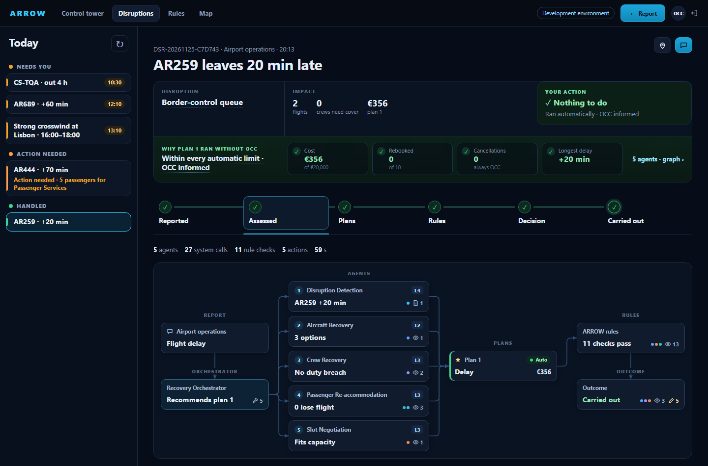
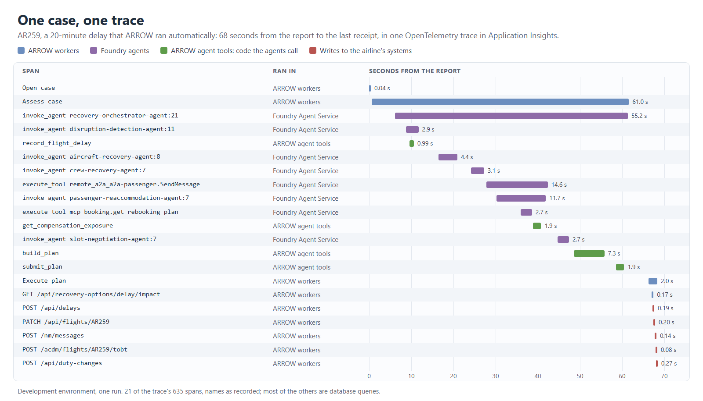
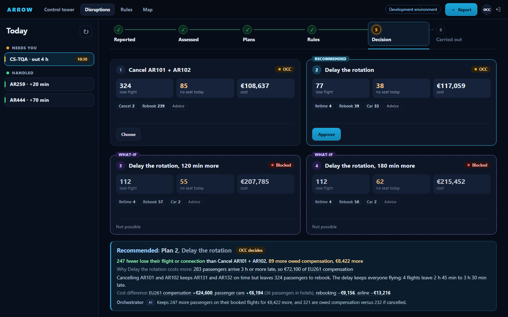

# Agentic disruption recovery for airlines on Azure

When a disruption hits, an airline's Operations Control Centre (OCC) must re-plan aircraft, crews,
slots and passengers together, and every minute costs money. AI agents can assess a disruption
across every desk at once. The harder question is what they should be allowed to do. The Agentic
Realtime Recovery Orchestration Workflow (ARROW), a reference implementation on Azure, explores
that question.

## The business problem

Disruption is a network problem: 44% of Europe's average departure delay in 2025 was knock-on
delay from earlier flights [1]. Lisbon, on one runway near capacity, was the least punctual of
Europe's 30 busiest airports [2].

A minute of delay at the gate costs an airline about €45 while the delay stays under 30 minutes,
and €166 averaged over all delays, knock-on included; passengers' rebooking, care, compensation and
lost future bookings are the largest part [3].

Under Regulation (EC) No 261/2004 (EU261), passengers whose flight arrives three or more hours
late or is cancelled at short notice can be owed €250 to €600 each, unless extraordinary
circumstances caused it [4].

ARROW's scenario is a Portuguese airline with a Lisbon hub and 900 flights a day. At 09:45 on its
sample day, a hydraulic leak grounds the Airbus A320neo CS-TQA for four hours, and its next four
flights must wait or be cancelled. ARROW builds two plans. *Cancel AR101 + AR102* costs €108,637,
and 324 passengers lose a flight or connection. *Delay the rotation* costs €117,059, and 77 do.
ARROW recommends the delay: 247 fewer passengers lose a flight or connection, for €8,422 more.
Approving it is the duty manager's call.

## How ARROW works

A case starts with a report from the duty manager or an event from an airline system. Azure
Service Bus queues the case for a recovery orchestrator in Microsoft Foundry Agent Service.

*Figure 1. ARROW on Azure; the airline's systems stay outside.*

The Disruption Detection agent records what the report says with a typed tool, and code checks
every value. The Aircraft Recovery agent lists the options. The orchestrator takes them one at a
time, delay first, asking the Crew, Passenger and, when departures move, Slot agents over the
Agent-to-Agent (A2A) protocol. For each option, code builds and prices a plan. The loop stops at
the first plan that may run automatically, or after four.

*Figure 2. Agents assess one option at a time; code builds and routes each plan.*

> **Agents read. Code acts. People decide.** Agents assess and propose without changing airline
> systems. Code checks, prices and carries out plans. Duty managers approve major decisions and
> changes to limits.

## 1. Agents only read

Each domain agent reads its own airline system through Model Context Protocol (MCP) tools, signed
in with its own Microsoft Entra Agent ID that holds read roles only [5, 6]. No agent has a tool
that changes an airline system. What agents hand back are typed findings and choices, such as an
option's identifier or a yes or no; code rejects anything else. Agents see passenger counts and
figures, never names or booking references, which supports data minimization under the General
Data Protection Regulation [7].

*Figure 3. AR259's 20-minute delay: five agents read and report; code builds, checks and carries out the plan.*

## 2. Code checks and acts

Policy lives in code, not in prompts. Code builds each plan from the systems' answers, prices it
[3, 4] and checks it against rules that each record their input, limit and result as a traffic
light. The worst light routes the plan:

- **Red, blocked:** a safety check fails or cannot be answered, such as a crew over its legal duty
  time with no standby crew free.
- **Amber, the OCC decides:** an aircraft change, a cancellation, a cost above €20,000 or more than
  10 rebookings.
- **Green, automatic:** everything within limits.

Under *Delay the rotation*, 39 of the 77 passengers who lose a flight or connection are rebooked
and 38 go to Passenger Services. Its checks:

| Check | Delay the rotation | Limit | Result |
|---|---|---|---|
| Cost | €117,059 | €20,000 | OCC decides |
| Passengers rebooked | 39 | 10 | OCC decides |
| Crew duty | no breach | legal duty limits | OK |
| Lisbon's capacity | fits | hourly capacity | OK |

Only a separate executor writes, and only for a plan that is automatic or approved. Each action
goes through its recipient's own interface and returns a receipt; a system refuses a change whose
data moved on since approval, and the case returns to the OCC. AR259's 20-minute delay (€356)
stayed within every automatic limit, so it ran without the OCC, which was informed. In this
development run, the orchestrator finished 59 seconds after the report (Figure 3) and the last
receipt arrived at 68 seconds, all in one OpenTelemetry trace in Application Insights [8].
Read-only agent identities, one write path and one trace per case also support incident
reporting under the Network and Information Security Directive (NIS2) [9].

*Figure 4. AR259 in one trace: 68 seconds from report to last receipt.*

## 3. People approve major decisions

CS-TQA's plans cross both automatic limits, so they wait for the duty manager, who sees them side
by side: what each costs, who loses a flight and why ARROW recommends one (Figure 5). While
deciding, the duty manager can ask the Case Assistant what happens if maintenance takes longer.
Asked about two and three hours more, it had code build both plans like any other, and the rules
block them: Lisbon's hourly capacity cannot take the moved flights, and three hours more also
breaks the crew's duty limit. A what-if plan never runs automatically. AI-written text, such as
the orchestrator's reason for its recommendation, is marked as AI, a choice informed by the
European Union's AI Act [10].

*Figure 5. CS-TQA's two plans and the two what-ifs the rules block, waiting for the duty manager.*

The limits belong to people too: one duty manager proposes a change, and a second must approve it.
If the agents fail, the OCC still gets any plans already built, without a recommendation; with
none, the case stops and nothing runs.

## Limitations and next steps

ARROW has not run live, and no airline outcome has been measured; its screens and timings come
from a development environment with sample airline systems. The notes on regulation are design
support, not legal advice or a compliance claim.

- **Integration is the largest piece of work.** Many airline and partner systems lack modern
  interfaces or MCP support. A proxied layer in Azure API Management, with small adapters, could
  expose them as tools while calling the systems as they are [11].
- **Rules to add:** union agreements beside the legal crew limits, and the minimum equipment list.
- **Proof:** a shadow trial beside an OCC, on read-only feeds, comparing ARROW's plans with the
  controllers' decisions.

## Get the code

The three rules (agents read, code acts, people decide) fit any operation where a wrong action is
expensive.

The repository [12] has the code, the architecture decisions and a guide that deploys ARROW into
your own Azure subscription.

## References

1. EUROCONTROL Network Manager, [Annual Network Operations Report 2025](https://www.eurocontrol.int/sites/default/files/2026-05/eurocontrol-annual-network-operations-report-2025.pdf), Figure 6, 2026; the 44% share is arithmetic on its figures.
2. EUROCONTROL Performance Review Commission, [Performance Review Report 2025](https://www.eurocontrol.int/sites/default/files/2026-03/eurocontrol-performance-review-report-2025.pdf), 2026.
3. EUROCONTROL, [Standard Inputs for Economic Analyses: cost of delay](https://standard-inputs.netlify.app/chapters/cost_of_delay.html), release 10.0.2, 2022 prices: Table 16.1, from the University of Westminster's study for EUROCONTROL, for the figures above; ARROW prices a plan's own delays at Table 16.2 (at the gate, without knock-on) and cancellations at the Standard Inputs' Table 14.1.
4. [Regulation (EC) No 261/2004](https://eur-lex.europa.eu/eli/reg/2004/261/oj/eng) on air passenger rights, amended by [Regulation (EU) 2026/2202](https://eur-lex.europa.eu/eli/reg/2026/2202/oj), which applies from 23 October 2027 with unchanged amounts; care is owed even in extraordinary circumstances ([McDonagh, C-12/11](https://eur-lex.europa.eu/legal-content/EN/TXT/?uri=CELEX:62011CJ0012)).
5. Microsoft Learn, [Connect agents to Model Context Protocol servers](https://learn.microsoft.com/azure/foundry/agents/how-to/tools/model-context-protocol) and [Connect to an A2A agent endpoint](https://learn.microsoft.com/azure/foundry/agents/how-to/tools/agent-to-agent).
6. Microsoft Learn, [What are agent identities in Microsoft Entra Agent ID?](https://learn.microsoft.com/entra/agent-id/what-are-agent-identities)
7. [Regulation (EU) 2016/679](https://eur-lex.europa.eu/eli/reg/2016/679/oj/eng), the General Data Protection Regulation.
8. Microsoft Learn, [Agent tracing overview](https://learn.microsoft.com/azure/foundry/observability/concepts/trace-agent-concept) for Microsoft Foundry, with OpenTelemetry.
9. [Directive (EU) 2022/2555](https://eur-lex.europa.eu/eli/dir/2022/2555/oj/eng) (NIS2) and Portugal's [Decree-Law 125/2025](https://diariodarepublica.pt/dr/detalhe/decreto-lei/125-2025-962603401).
10. [Regulation (EU) 2024/1689](https://eur-lex.europa.eu/eli/reg/2024/1689/oj/eng), the Artificial Intelligence Act, as amended by [Regulation (EU) 2026/1744](https://eur-lex.europa.eu/legal-content/EN/TXT/?uri=CELEX:32026R1744).
11. Microsoft Learn, [Expose a REST API in API Management as an MCP server](https://learn.microsoft.com/azure/api-management/export-rest-mcp-server).
12. [ARROW on GitHub](https://github.com/simonm43/agentic-airline-disruption-recovery): the code, its tests and the step-by-step deployment guide.
