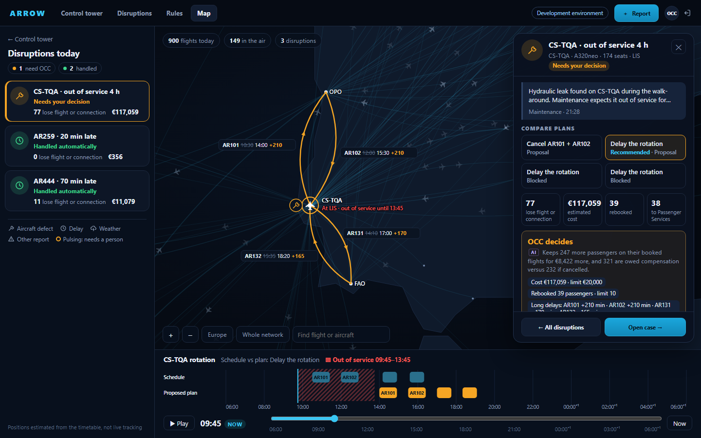
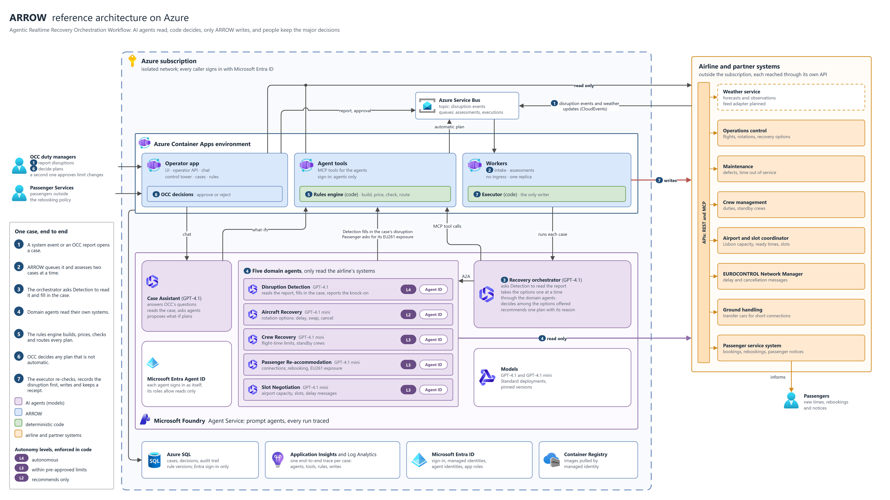

# Agentic disruption recovery for airlines on Azure

*Agentic Realtime Recovery Orchestration Workflow (ARROW) lets AI agents assess a disruption
across every desk at once.*

## The business problem

Disruption is a network problem: 44% of Europe's average departure delay in 2025 was knock-on
delay from earlier flights [1]. Lisbon, on one runway near capacity, was the least punctual of
Europe's 30 busiest airports [2].

A minute of delay at the gate costs an airline about EUR 45 while the delay stays under 30
minutes, and EUR 166 averaged over all delays [3]: the longer the delay, the more each minute
costs. These figures cover crew, maintenance and a little fuel, passengers' rebooking, care,
compensation and lost future bookings, and knock-on delay; passenger costs are the largest part.

Under Regulation (EC) No 261/2004 (EU261), passengers whose flight arrives three or more hours
late or is cancelled at short notice are owed EUR 250 to 600 each, unless extraordinary
circumstances caused it [4]. Airlines' EU261 costs were estimated at about EUR 5 billion in 2018
[5].

ARROW's scenario is a Portuguese airline with a Lisbon hub and 900 flights a day. Its
Operations Control Centre (OCC) re-plans aircraft, crews, slots and passengers desk by desk; a
recovery takes 12 to 24 hours.

At 09:45, a hydraulic leak grounds the A320neo CS-TQA for four hours. Its next four flights must
wait or be cancelled; crews, a full Lisbon hour and hundreds of passengers depend on the
choice.

*Figure 1. CS-TQA's recommended plan on ARROW's map.*

## How ARROW works

ARROW is a reference implementation on Azure [6]. Agents read, code decides, only ARROW writes,
and a person approves every major decision.

*Figure 2. ARROW on Azure; the airline's systems stay outside.*

A duty manager's report, or an airline system's event, opens a case queued on Azure Service Bus.
In Microsoft Foundry Agent Service, a recovery orchestrator then runs a bounded loop (Figure 3).

The Disruption Detection agent records the disruption with a typed tool, such as
`record_aircraft_defect`, whose every value code checks. Aircraft Recovery lists the options; the
orchestrator takes them one at a time, delay first, asking the Crew, Passenger and, when
departures move, Slot agents over the Agent-to-Agent (A2A) protocol. Each reads its own system
through Model Context Protocol (MCP) tools, signed in with its own Microsoft Entra Agent ID
holding read roles only [7, 8].

For each option, the orchestrator's decision holds only identifiers and yes-or-no choices; the
loop stops at the first plan that can run automatically, or after four plans.

*Figure 3. Agents assess one option at a time; code builds and routes each plan.*

*Figure 4. The loop in the operator app: AR259's 20-minute delay, assessed by five agents and run automatically.*

## How code checks and routes every plan

Agents that write, or policy in prompts, were rejected: a persuasive mistake would become an
operational action. Code builds each plan from the systems' answers and prices it [3, 4]. Each
rule records its input, limit and result as a traffic light; the worst light routes the plan:

- **Red, blocked:** a safety check fails or cannot be answered, such as a crew over its legal
  duty time with no standby crew free.
- **Amber, the OCC decides:** a major decision or a crossed limit, such as an aircraft change,
  a cancellation, cost above EUR 20,000 or more than 10 rebookings. Only a second duty manager
  can change a limit.
- **Green, automatic:** everything within limits.

For CS-TQA, cancelling two flights costs about EUR 109,000, and 324 passengers lose a flight or
connection; delaying costs about EUR 118,000, and 77 do. The delay plan's checks include:

| Check | Plan | Limit | Result |
|---|---|---|---|
| Cost | EUR 117,697 | EUR 20,000 | OCC decides |
| Passengers rebooked | 38 | 10 | OCC decides |
| Crew duty | 575 minutes | 720, the legal limit | OK |
| Lisbon's capacity | fits | hourly allocation | OK |

AR259's 20-minute delay (EUR 356), by contrast, runs automatically within every limit. A duty
manager can also ask the Case Assistant chat "what if?": code builds and checks that plan the
same way, but never runs it automatically.

*Figure 5. CS-TQA's plans and blocked what-ifs, from another run.*

Only a separate executor writes, and only for an automatic or approved plan: each action goes
through its recipient's application programming interface (API) with a receipt. Check codes
make systems refuse changes made stale since approval, returning the case to the OCC. Each
case is one OpenTelemetry trace in Application Insights, holding no passenger data [9].

*Figure 6. AR259 in one trace: 68 seconds from report to last receipt.*

## Regulation by design

- **The European Union's AI Act:** its Article 50 transparency duties apply from 2 August 2026;
  ARROW marks AI-written text as AI [10].
- **The General Data Protection Regulation (GDPR):** agents see only counts and figures, never
  names [11].
- **The Network and Information Security Directive (NIS2),** which covers air carriers:
  least-privilege identities, one writer and one trace per case support incident reporting [12].

This is design support, not legal advice or a compliance claim.

## Limitations and next steps

ARROW has not run live, and no airline outcome has been measured; its screens come from a
development environment with sample airline systems.

- **Integration is the largest piece of work.** Many airline and partner back ends lack modern
  APIs or MCP. A proxied layer of Azure API Management and small adapter containers would
  expose tools such as `get_recovery_options` while calling the booking, crew and operations
  systems [13].
- **Rules to add:** union agreements beside the legal crew limits, and the minimum equipment list.
- **Proof:** a shadow trial beside an OCC, on read-only feeds, would score ARROW's plans against
  controllers' decisions on recovery time, EU261 cost per disrupted passenger, cancellations and
  Net Promoter Score (NPS).

## Get the code

The pattern fits any operation where a wrong action is expensive. The repository [6] has the
code in `src`, the architecture and decisions in its README, and a guide, `infra/README.md`, that
deploys ARROW into your own Azure subscription.

## References

1. EUROCONTROL Network Manager, [Annual Network Operations Report 2025](https://www.eurocontrol.int/sites/default/files/2026-05/eurocontrol-annual-network-operations-report-2025.pdf), Figure 6, 2026; the 44% share is arithmetic on its figures.
2. EUROCONTROL Performance Review Commission, [Performance Review Report 2025](https://www.eurocontrol.int/sites/default/files/2026-03/eurocontrol-performance-review-report-2025.pdf), 2026.
3. EUROCONTROL, [Standard Inputs for Economic Analyses: cost of delay](https://standard-inputs.netlify.app/chapters/cost_of_delay.html), release 10.0.2, 2022 prices: Table 16.1, from the University of Westminster's study for EUROCONTROL, for the figures above; ARROW prices a plan's own delays at Table 16.2 (at the gate, without knock-on) and cancellations at the Standard Inputs' Table 14.1.
4. [Regulation (EC) No 261/2004](https://eur-lex.europa.eu/eli/reg/2004/261/oj/eng) on air passenger rights, amended by [Regulation (EU) 2026/2202](https://eur-lex.europa.eu/eli/reg/2026/2202/oj), which applies from 23 October 2027 with unchanged amounts; care is owed even in extraordinary circumstances ([McDonagh, C-12/11](https://eur-lex.europa.eu/legal-content/EN/TXT/?uri=CELEX:62011CJ0012)).
5. Steer for the European Commission, [Study on the current level of protection of air passenger rights in the EU](https://doi.org/10.2832/529370), 2020.
6. [ARROW on GitHub](https://github.com/simonm43/agentic-airline-disruption-recovery): the code, its tests and the step-by-step deployment guide.
7. Microsoft Learn, [Connect agents to Model Context Protocol servers](https://learn.microsoft.com/azure/foundry/agents/how-to/tools/model-context-protocol) and [Connect to an A2A agent endpoint](https://learn.microsoft.com/azure/foundry/agents/how-to/tools/agent-to-agent).
8. Microsoft Learn, [What are agent identities in Microsoft Entra Agent ID?](https://learn.microsoft.com/entra/agent-id/what-are-agent-identities)
9. Microsoft Learn, [Agent tracing overview](https://learn.microsoft.com/azure/foundry/observability/concepts/trace-agent-concept) for Microsoft Foundry, with OpenTelemetry.
10. [Regulation (EU) 2024/1689](https://eur-lex.europa.eu/eli/reg/2024/1689/oj/eng), the Artificial Intelligence Act, as amended by [Regulation (EU) 2026/1744](https://eur-lex.europa.eu/legal-content/EN/TXT/?uri=CELEX:32026R1744).
11. [Regulation (EU) 2016/679](https://eur-lex.europa.eu/eli/reg/2016/679/oj/eng), the General Data Protection Regulation.
12. [Directive (EU) 2022/2555](https://eur-lex.europa.eu/eli/dir/2022/2555/oj/eng) (NIS2) and Portugal's [Decree-Law 125/2025](https://diariodarepublica.pt/dr/detalhe/decreto-lei/125-2025-962603401).
13. Microsoft Learn, [Expose a REST API in API Management as an MCP server](https://learn.microsoft.com/azure/api-management/export-rest-mcp-server).
