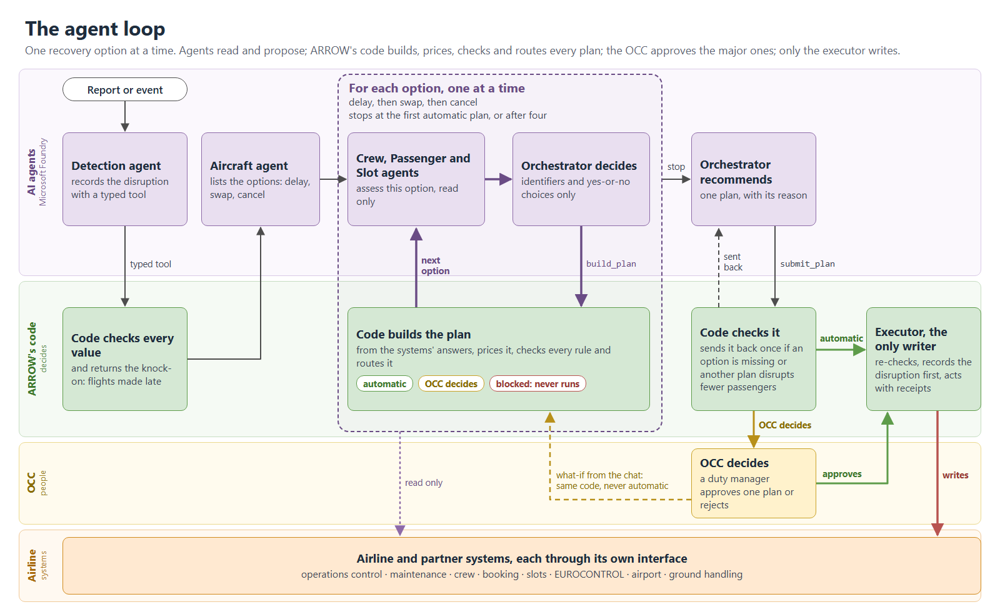

# Agents propose, code decides: governed agentic recovery for airlines on Azure

How much should an AI agent be allowed to do on its own? Where a wrong action is expensive, a
useful answer is a split. Agents assess and propose. Code checks and prices every plan and decides
whether it runs automatically, needs a person's approval or is blocked. One separate executor is
the only part that can change another system. This post shows the pattern on Azure with the
Agentic Realtime Recovery Orchestration Workflow (ARROW), a reference implementation for airline
disruption recovery.

## Four flights, one grounded aircraft

At 09:45 on ARROW's sample day at Lisbon, a hydraulic leak grounds CS-TQA, an Airbus A320neo, for
four hours. Its next four flights are at risk. Which plan should the duty manager approve?

Cancel two flights and the estimated cost is EUR 109,000; 324 passengers lose a flight or
connection. Delay instead and the cost rises to about EUR 118,000, but that number falls to 77.
The duty manager can see what the extra EUR 9,000 buys: 247 fewer passengers losing a flight or
connection.

*Figure 1. CS-TQA's recommended plan on ARROW's map.*

## What disruption costs an airline

The scenario models a Portuguese airline operating 900 flights a day. Its Operations Control
Centre (OCC) replans aircraft, crew, slots and passenger connections desk by desk. ARROW targets
the time it takes to put a feasible plan in front of the duty manager, not the time it takes the
airline to return to schedule.

Disruption is a network problem: 44% of Europe's average departure delay in 2025 was knock-on
delay from earlier flights [1]. Lisbon, on one runway near capacity, was the least punctual of
Europe's 30 busiest airports [2].

At the gate, a minute of delay costs about EUR 45 for delays under 30 minutes and EUR 166 averaged
across delays of all lengths. Passenger costs, including missed connections and rebooking, are the
largest component [3]. Delay can also trigger compensation: under European Union passenger rights
rules (EU261), an arrival delay of at least three hours or a short-notice cancellation can entitle
eligible passengers to EUR 250–600 each, subject to exceptions [4].

Faster, better-informed decisions are worth money, but no airline will let software change its
operation unchecked. The architecture has to deliver both.

## How ARROW works

In ARROW's Azure reference implementation [5], the airline's systems remain the sources of record.
ARROW asks each for the facts it needs to assess a plan.

*Figure 2. ARROW on Azure; the airline's systems stay outside.*

A duty manager's report, or an airline system's event, opens a case queued on Azure Service Bus.
In Microsoft Foundry Agent Service, a recovery orchestrator then runs a bounded loop (Figure 3).

The detection agent extracts the aircraft and expected downtime from the report; code validates
both. The Aircraft Recovery agent lists options. Starting with delay, the orchestrator asks the
crew and passenger agents about each option, and the slot agent when departures move. It calls
them over the Agent-to-Agent (A2A) protocol. Each reads its own system through Model Context
Protocol (MCP) tools, signed in with its own Microsoft Entra Agent ID that holds read roles only
[6, 7].

The orchestrator returns identifiers and yes-or-no choices, not instructions for airline systems
to execute; code rejects anything else. The loop stops at the first plan eligible to run
automatically, or after four plans.

*Figure 3. Agents assess one option at a time; code builds and routes each plan.*

*Figure 4. The loop in the operator app: AR259's 20-minute delay, assessed by five agents and run automatically.*

## Where the agents' authority ends

A plausible recommendation can still be wrong. Agents cannot change a policy threshold or call the
executor. Code prices the plan [3, 4] and records the input, limit and result for each check. The
worst traffic light wins:

- **Red, blocked:** a safety check fails or cannot be answered, such as a crew over its legal duty
  time with no standby crew free.
- **Amber, the OCC decides:** aircraft changes, cancellations, or plans exceeding EUR 20,000 or 10
  rebookings require approval. Changing either threshold requires a second duty manager's
  approval.
- **Green, automatic:** everything within limits.

CS-TQA's delay plan passes the crew and airport checks, but exceeds both automatic limits. The
rebooking check counts 38 passengers to rebook, not everyone who would lose a flight or
connection.

| Check | Plan | Limit | Result |
|---|---|---|---|
| Cost | EUR 117,697 | EUR 20,000 | OCC decides |
| Passengers rebooked | 38 | 10 | OCC decides |
| Crew duty | 575 minutes | 720, the legal limit | OK |
| Lisbon's capacity | fits | hourly allocation | OK |

While a plan awaits approval, the duty manager can ask "what if maintenance takes another 30
minutes?" The Case Assistant sends the alternative through the same checks. A what-if plan never
runs automatically.

*Figure 5. CS-TQA's plans and blocked what-ifs, from another run.*

If assessment fails after retries, the OCC receives any plans already built, without an AI
recommendation. If there are none, the case stops and nothing runs. Execution has its own
safeguard: if the executor cannot record CS-TQA's newly reported defect in maintenance, it does not
retime flights or rebook passengers.

## From report to receipt: 68 seconds

AR259's EUR 356 delay plan passed every check. In this run, 68 seconds elapsed from the report to
the last execution receipt. That is one run in a development environment, not the time for an
airline to recover.

*Figure 6. AR259's 20-minute delay as one OpenTelemetry trace in Application Insights [8].*

## Design decisions

- **One agent per desk.** Each domain agent has its own instructions, tools and identity, so no
  agent sees every desk and each leaves its own audit trail [7]. The price: seven agents to
  version, evaluate and keep consistent.
- **Typed tools, not free-form actions.** Agents choose among options the airline's systems offer,
  and code validates every value. Behaviour stays predictable and testable, but an agent cannot
  propose a recovery the tools don't offer.
- **A queue in front of the agents.** Azure Service Bus absorbs bursts of reports, retries
  temporary failures and sets aside a case that keeps failing, so nothing is lost while a worker
  restarts.
- **Approvals that cannot go stale.** Before writing, the executor re-checks what the plan depends
  on, and each write is conditional where the system allows. If anything changed since approval,
  the write is refused and the case returns to the OCC. That is safer than overwriting, though
  some approvals will bounce back.

Running costs are small next to the delay costs above. Model tokens came to EUR 0.04–0.11 a case
in a development run at Azure list prices, and the platform for one environment is estimated at
about EUR 290 a month, before integration and support.

## Design considerations for regulated operations

- **Transparency:** the duty manager sees which explanations are AI-generated. The European
  Union's AI Act informs this choice [9].
- **Data minimisation:** agents receive passenger counts and figures, not names or booking
  references. Case traces contain no passenger data [10].
- **Traceability:** separate read identities, a single write path and a trace per case help
  investigators reconstruct what happened [11].

These choices support an airline's own assessment under the AI Act, the General Data Protection
Regulation and the Network and Information Security Directive (NIS2). They do not establish
compliance.

## Limitations and next steps

ARROW has not run live, and no airline outcome has been measured. The case costs and timings
illustrate the reference implementation, not expected production performance or savings.

- **Integration is the largest piece of work.** An airline would connect its aircraft, crew, slot,
  schedule and passenger systems, and many airline and partner systems predate MCP. Adapters
  behind Azure API Management can expose selected tools while calling existing interfaces [12].
- **Rules to add:** union agreements beside the legal crew limits, and the minimum equipment list.
- **Test the decision, not just the clock.** Run ARROW alongside controllers on the same
  disruptions, using read-only feeds. Compare the time to the first plan a duty manager judges
  usable, record why plans are rejected, and compare projected cancellations and compensation. A
  shadow trial can test those estimates; it cannot establish realised savings.

## Get the code

The same split applies wherever a wrong action is expensive and people must stay accountable, such
as payments, grid operations or hospital capacity. To see the boundary in ARROW, compare CS-TQA's
grounded aircraft with AR259's short delay: both use the same rules, and only one plan can run
without a duty manager. The repository [5] includes the scenarios, architecture decisions and
deployment guide.

## References

1. EUROCONTROL Network Manager, [Annual Network Operations Report 2025](https://www.eurocontrol.int/sites/default/files/2026-05/eurocontrol-annual-network-operations-report-2025.pdf), Figure 6, 2026; the 44% share is arithmetic on its figures.
2. EUROCONTROL Performance Review Commission, [Performance Review Report 2025](https://www.eurocontrol.int/sites/default/files/2026-03/eurocontrol-performance-review-report-2025.pdf), 2026.
3. EUROCONTROL, [Standard Inputs for Economic Analyses: cost of delay](https://standard-inputs.netlify.app/chapters/cost_of_delay.html), release 10.0.2, 2022 prices: Table 16.1, from the University of Westminster's study for EUROCONTROL, for the figures above; ARROW prices a plan's own delays at Table 16.2 (at the gate, without knock-on) and cancellations at the Standard Inputs' Table 14.1.
4. [Regulation (EC) No 261/2004](https://eur-lex.europa.eu/eli/reg/2004/261/oj/eng) on air passenger rights, amended by [Regulation (EU) 2026/2202](https://eur-lex.europa.eu/eli/reg/2026/2202/oj), which applies from 23 October 2027 with unchanged amounts; care is owed even in extraordinary circumstances ([McDonagh, C-12/11](https://eur-lex.europa.eu/legal-content/EN/TXT/?uri=CELEX:62011CJ0012)).
5. [ARROW on GitHub](https://github.com/simonm43/agentic-airline-disruption-recovery): the code, its tests and the step-by-step deployment guide.
6. Microsoft Learn, [Connect agents to Model Context Protocol servers](https://learn.microsoft.com/azure/foundry/agents/how-to/tools/model-context-protocol) and [Connect to an A2A agent endpoint](https://learn.microsoft.com/azure/foundry/agents/how-to/tools/agent-to-agent).
7. Microsoft Learn, [What are agent identities in Microsoft Entra Agent ID?](https://learn.microsoft.com/entra/agent-id/what-are-agent-identities)
8. Microsoft Learn, [Agent tracing overview](https://learn.microsoft.com/azure/foundry/observability/concepts/trace-agent-concept) for Microsoft Foundry, with OpenTelemetry.
9. [Regulation (EU) 2024/1689](https://eur-lex.europa.eu/eli/reg/2024/1689/oj/eng), the Artificial Intelligence Act, as amended by [Regulation (EU) 2026/1744](https://eur-lex.europa.eu/legal-content/EN/TXT/?uri=CELEX:32026R1744).
10. [Regulation (EU) 2016/679](https://eur-lex.europa.eu/eli/reg/2016/679/oj/eng), the General Data Protection Regulation.
11. [Directive (EU) 2022/2555](https://eur-lex.europa.eu/eli/dir/2022/2555/oj/eng) (NIS2) and Portugal's [Decree-Law 125/2025](https://diariodarepublica.pt/dr/detalhe/decreto-lei/125-2025-962603401).
12. Microsoft Learn, [Expose a REST API in API Management as an MCP server](https://learn.microsoft.com/azure/api-management/export-rest-mcp-server).
